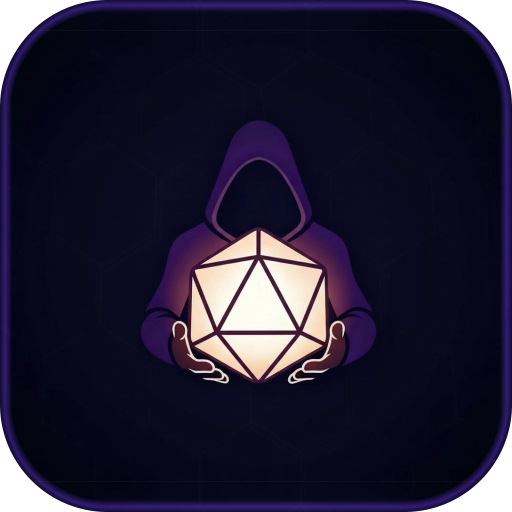
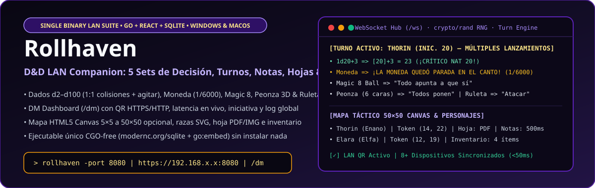
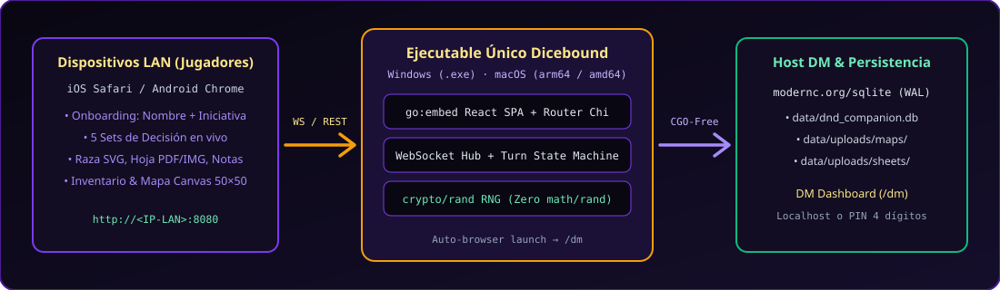

<div align="center">



# Dicebound

**Cross-Platform Single-Binary D&D LAN Companion — 5 Cryptographic Decision Sets, Live Turn & Initiative Tracker, DM Dashboard with QR Onboarding, Character Sheets, Inventory, Notes & 5×5–50×50 HTML5 Canvas Tactical Map**

[](https://github.com/SilverFeit/Dicebound/releases/latest)
[](#download--quick-start)
[-10b981?style=flat-square)](#architecture)
[](#architecture)
[](LICENSE)

```bash
# Run on macOS / Linux or double-click dicebound-windows-amd64.exe on Windows:
./dicebound-mac-arm64 -port 8080
```

[**Download Binaries (Windows & macOS)**](https://github.com/SilverFeit/Dicebound/releases/latest) · [**5 Decision Sets**](#5-cryptographic-decision-sets-cryptorand) · [**DM Dashboard & QR**](#dungeon-master-dashboard-dm) · [**Tactical Map (5×5–50×50)**](#tactical-map-canvas-55-to-5050) · [**User Guide**](docs/USER_GUIDE.md) · [**Technical Spec**](docs/SPEC.md) · [**Español**](#-español--resumen-del-proyecto)

<br />



</div>

---

## Overview

**Dicebound** is a self-contained local-network (LAN) tabletop companion for **Dungeons & Dragons** packaged as a **single native executable** for **Windows (`.exe`)** and **macOS (`arm64`, `amd64`, `.app` & `.dmg`)** — requiring zero external runtimes (no Node.js, Python, Docker, or CGO compilers).

When launched on the Dungeon Master's laptop or desktop, Dicebound automatically:
1. Detects your active Wi-Fi/Ethernet LAN IPv4 address (filtering out loopback, Docker, VirtualBox, VMWare, WSL, and VPN adapters).
2. Initializes a pure-Go SQLite database (`data/dnd_companion.db`) via `modernc.org/sqlite`.
3. Serves the embedded React 18 SPA over HTTP and WebSockets (`/ws`) and opens the **DM Dashboard** (`http://localhost:8080/dm`) automatically.
4. Generates an interactive **QR code** so every player at the table can join from their phone/tablet browser in seconds by entering just their **Name** and **Initiative**.

<details open>
<summary><strong>🇪🇸 Español — Resumen del Proyecto</strong></summary>

<br />

**Dicebound** es una suite de mesa local (LAN) para **Dungeons & Dragons** compilada en un **único ejecutable nativo para Windows (`.exe`) y macOS (`arm64`/`amd64`, `.app` y `.dmg`)**, sin dependencias externas:

- **Pantalla de Entrada Minimalista:** Cada jugador en red local entra desde la IP LAN o escaneando el **Código QR** del DM e ingresa únicamente su **Nombre** e **Iniciativa**.
- **5 Sets de Decisión Criptográficos (`crypto/rand` en Go):**
  1. **Dados Poliédricos Completos:** `d2`, `d4`, `d6`, `d8`, `d10`, `d12`, `d20` y `d100` con notación `NdX+M` y resaltado de críticos en `d20` (Nat 20 verde / Nat 1 rojo).
  2. **Moneda Físicamente Real:** Simula Cara (`49.9917%`), Cruz (`49.9917%`) y la remota posibilidad real de caer parada en el **Canto** ($1/6000 \approx 0.0167\%$).
  3. **Magic 8 Ball:** Las 20 respuestas clásicas (10 afirmativas, 5 neutras, 5 negativas) + selector de modo **Sí / No Estricto (50/50)**.
  4. **Peonza / Pirinola Personalizable:** Preset de fábrica de 6 caras y editor dinámico de **4 a 12 caras** con animación sincronizada.
  5. **Ruleta de Decisión:** Ruleta SVG configurable por el usuario con selección uniforme del servidor.
- **Resultados del Turno Actual en Vivo:** Todos los dispositivos ven el resultado del turno en curso. Durante su turno, el jugador puede lanzar cualquier ítem múltiples veces hasta presionar manualmente **"Pasar Turno"**.
- **Dashboard del Dungeon Master (`/dm`):** Acceso local protegido (o con PIN autogenerado de 4 dígitos para tablets), QR de conexión, listado vivo de IPs/dispositivos/latencia, edición/arrastre de iniciativa, forzado de turnos, log global y bloc de notas privado.
- **Mapa Táctico Opcional (`5×5` a `50×50`), Razas, Hojas e Inventario:** El DM puede activar/desactivar el mapa en vivo, subir una imagen de fondo y ajustar la grilla de `5×5` a `50×50` en HTML5 `<canvas>` (60 fps con Pan y Zoom). Cada jugador elige su ícono de raza (9 SVG offline), sube su hoja de personaje (PDF/PNG/JPG hasta 10 MB), gestiona su inventario (`+/-`) y escribe notas con autoguardado cada 500 ms.

</details>

---

## Architecture

<div align="center">
 Go Single Binary (Embed React + WebSocket Hub + crypto/rand) -> SQLite" width="100%" />
</div>

- **Backend (`cmd/app`, `pkg/*`):** Go + `go-chi/chi/v5` + `coder/websocket` + `modernc.org/sqlite` (CGO-free) + `go:embed` static SPA bundle.
- **Frontend (`frontend/src`):** React 18 + TypeScript + Tailwind CSS + HTML5 `<canvas>` + `qrcode.react` + `lucide-react`.

---

## 5 Cryptographic Decision Sets (`crypto/rand`)

All randomness is computed server-side in `pkg/engine` using `crypto/rand` (`math/rand` is strictly forbidden and verified by `TestNoMathRandInEngine`):

| Set | Capability | Implementation |
|---|---|---|
| **1. Polyhedral Dice** | `d2`, `d4`, `d6`, `d8`, `d10`, `d12`, `d20`, `d100` + `NdX+M` + `1:1` collision tray (hold-to-shake & phone shake) | `pkg/engine/dice.go`, `DicePhysicsArena.tsx` |
| **2. Physics Coin** | Cara (`5999/12000`), Cruz (`5999/12000`), **Canto (`1/6000`)** | `pkg/engine/coin.go` (validated with 600,000-iteration Monte Carlo test) |
| **3. Magic 8 Ball** | 20 classic answers (10/5/5) + 50/50 Strict Yes/No mode | `pkg/engine/magic8.go` |
| **4. Peonza (4–12 Faces)** | 3D perspective bouncing top (wall speed decay, 4–12 faces) | `pkg/engine/spinner.go`, `PeonzaArenaCanvas.tsx` |
| **5. Decision Wheel** | Top-down 2–24 custom colored wedges + 2.5s spin sync | `pkg/engine/wheel.go` |

---

## Dungeon Master Dashboard (`/dm`)

- **Localhost Auto-Auth + 4-Digit PIN:** Automatically unlocked on `127.0.0.1` / `::1`; remote LAN tablets prompt for the 4-digit session PIN printed in the host console.
- **QR Code & Presence Monitor:** Displays `http://<IP_LAN>:<PORT>` QR code, client IPs, device/browser User-Agent summary, online/absent status, and WebSocket RTT latency (`ms`).
- **Initiative & Turn Override:** Drag-and-drop row reordering, inline initiative edits, Force Next/Previous Turn, direct turn assignment, and player kick.
- **Live Audit Log & Private DM Notepad:** Real-time roll log and 500 ms debounced private notes persisted to SQLite.

---

## Tactical Map Canvas (`5×5` to `50×50`)

- **Zero DOM Overhead:** Single HTML5 `<canvas>` rendered via `requestAnimationFrame` (handles `50×50` = 2,500 cells at 60 fps on phones).
- **DM Controls:** Global live toggle (immediately shows/hides the Map tab on all connected players' screens), background image upload, independent rows/cols (`5–50`), grid color/opacity sliders, token visibility toggle, and position reset.
- **Strict Permissions:** Players move only their own token; the DM can move any token on the board.

---

## Download & Quick Start

Grab the latest builds from [**Releases**](https://github.com/SilverFeit/Dicebound/releases/latest):

- **Windows 10/11 (64-bit):** `dicebound-windows-amd64.exe` (or `Dicebound-1.0.0-windows-amd64.zip`)
- **macOS (Apple Silicon & Intel):** `Dicebound-1.0.0-macOS.dmg` (Universal `Dicebound.app`) or standalone CLI binaries `dicebound-mac-arm64` / `dicebound-mac-amd64`

> **Firewall & Gatekeeper Note:** See [docs/USER_GUIDE.md](docs/USER_GUIDE.md) for 1-click instructions to allow LAN access in **Windows Defender Firewall** and open unsigned binaries on **macOS Gatekeeper** (`xattr -cr`).

### Build & Test from Source

```bash
# Run Go Vet, Monte Carlo (600k coin flips), and 8-client WebSocket tests
make build-frontend
make test

# Cross-compile Windows .exe, macOS arm64/amd64, Dicebound.app & .dmg
./Scripts/package_release.sh
```
